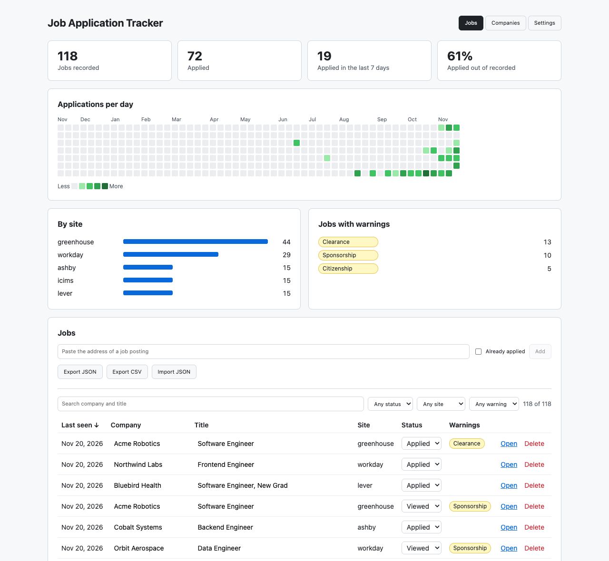
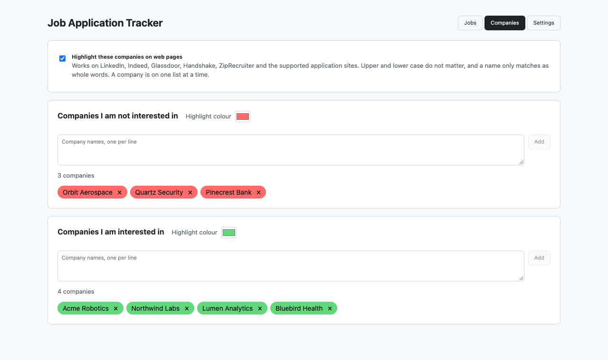

# Job Application Tracker

English | [简体中文](README.zh-CN.md)

A browser extension that remembers which job postings you have already viewed or applied to, so you stop opening the same job twice. Everything stays in your browser.

**[Download the latest build](https://github.com/peterjiatong/Job-Application-Tracker/releases/latest/download/job-application-tracker-chrome.zip)** · [How to install it](#install)

## The problem

The same job shows up on LinkedIn, Indeed, Handshake and the company's own careers page. From the listings alone you cannot tell whether two of them are the same posting or just share a title, so you click through and read the description again.

All of those listings lead to the same application page on an applicant tracking system (Workday, Greenhouse and others), and its address carries a stable job id. This extension reads that id, records it locally, and tells you the moment you land on a job you have seen before.

## What it does

- **Recognises a job across job boards.** On a supported application site it identifies the job by site, company and job id, ignoring tracking parameters in the address.
- **Tells you when you have been there.** A small box in the top-right corner says "You've seen this job" with the date and time, or "You applied to this job".
- **Records automatically or asks first.** In automatic mode a job is recorded when you open it. In manual mode the extension asks.
- **Marks jobs as applied.** One click in the box, or automatically when you click the form's "Submit application" button. Either can be undone.
- **Warns about restrictions.** It scans the job description for citizenship, security clearance and visa sponsorship requirements and quotes the sentence it found, so you can judge for yourself. The rules are regular expressions you can edit.
- **Highlights companies on job boards.** Keep one list of companies you are not interested in and one of companies you are. Their names are highlighted on LinkedIn, Indeed and the other supported sites, in colours you choose. Add a company from the toolbar popup, by selecting its name and right-clicking, or by pasting a list.
- **Dashboard.** Applications per day over the last year, totals, a searchable and editable list of every recorded job, and export to JSON or CSV.
- **English and Chinese.** Follows the browser's language, or pick one in the settings.





The pictures use made-up sample data.

## Supported sites

Jobs are recorded on these application sites:

| Site | Recognised by |
| --- | --- |
| Workday | `*.myworkdayjobs.com`, `*.myworkdaysite.com` |
| Greenhouse | `boards.greenhouse.io`, `job-boards.greenhouse.io` (also the `.eu` hosts) |
| Lever | `jobs.lever.co`, `jobs.eu.lever.co` |
| Ashby | `jobs.ashbyhq.com` |
| iCIMS | `*.icims.com` |
| SmartRecruiters | `jobs.smartrecruiters.com` |
| Workable | `apply.workable.com` |

Company names are highlighted on those sites and on LinkedIn, Indeed, Glassdoor, Handshake and ZipRecruiter. No jobs are recorded on the job boards themselves; they keep their own history of what you applied to.

A job on any other site can be recorded by hand: open the toolbar popup and choose **Record this page**, or paste its address on the dashboard.

## Install

The extension is not in the Chrome Web Store or on Firefox Add-ons yet. For now it is loaded by hand into Chrome or another Chromium browser (Edge, Brave, Arc).

### Download the latest build

1. Download [job-application-tracker-chrome.zip](https://github.com/peterjiatong/Job-Application-Tracker/releases/latest/download/job-application-tracker-chrome.zip). It is built and tested automatically after every change to this repository, so it is always the newest version. Earlier builds are not kept.
2. Unzip it, and put the folder somewhere it can stay.
3. Open `chrome://extensions`.
4. Turn on **Developer mode** in the top-right corner.
5. Click **Load unpacked** and choose the unzipped folder.

Leave that folder where it is. The browser identifies an unpacked extension by its location, and moving the folder makes it look like a different extension with empty storage.

Chrome cannot install the zip file itself, and an extension loaded this way does not update on its own. To update, download the zip again, replace the contents of the same folder with it, and click the reload arrow on the extension's card in `chrome://extensions`. Your records are kept.

### Or build it from source

You need [Node.js](https://nodejs.org) 22 or newer and [pnpm](https://pnpm.io).

```sh
git clone https://github.com/peterjiatong/Job-Application-Tracker.git
cd Job-Application-Tracker
pnpm install
pnpm release
```

Then load the folder `release/job-application-tracker-chrome` as in steps 3 to 5 above. To update, pull the new code, run `pnpm release` again, and click the reload arrow.

Firefox builds (`pnpm build:firefox`) have not been tested yet.

## Using it

- **Open a job posting** on a supported site. The box in the corner tells you whether it is new, seen or applied. Use `–` to shrink it to a small pill and `×` to close it.
- **Toolbar icon.** Shows the status of the current page, records pages the extension did not recognise, puts a company on one of your lists, and opens the dashboard.
- **Right-click a selected company name** to mark it as interested or not interested.
- **Dashboard.** *Jobs* has the chart, the numbers and the list. *Companies* has the two lists and their colours. *Settings* has the language, the recording mode and the warning rules.

## Privacy

- **No network requests.** The extension has no server and sends nothing anywhere. There are no analytics.
- **No account.** Your records live in the browser's local extension storage on your own computer.
- **Open source.** Everything it does is in this repository.

Permissions it asks for, and why:

| Permission | Used for |
| --- | --- |
| `storage` | Saving your records, lists and settings in the browser |
| `activeTab` | Letting the toolbar popup read the address of the tab you opened it on |
| `contextMenus` | The right-click entries for marking a company |
| Access to the sites listed above | Reading the job id and description on application sites, and highlighting company names on job boards |

It does not ask for access to all websites.

## Your data

Records are stored per browser profile. **Uninstalling the extension, or clearing its data, deletes them.** Use **Export JSON** on the dashboard for a backup; **Import JSON** restores it, also in another browser. Importing merges with what is already there instead of overwriting it.

## Known limitations

- Jobs embedded in a company's own website (for example a Greenhouse form at `example.com/careers`) are not recognised automatically. Record them from the toolbar popup.
- Clicking "Submit" marks a job as applied even if the form then refuses to submit. The box stays on screen with **Undo** in that case.
- On SmartRecruiters the application form lives at an address that does not identify the job, so submitting there is not detected.
- A short company name that is also an ordinary word (Block, Scale) highlights that word everywhere on the page.
- The warning rules look for wording, not meaning. They will miss some phrasings and flag some harmless ones, which is why the sentence is always shown.

## Development

```sh
pnpm dev        # start Chrome with the extension loaded and reload on change
pnpm test       # unit tests (Vitest)
pnpm compile    # type-check
pnpm build      # production build in .output/chrome-mv3
pnpm release    # build and copy to release/ for loading by hand
```

Every push to `main` runs the type-check and the tests on GitHub Actions and, if they pass, publishes the zip that the download link above points to (`.github/workflows/build.yml`).

Built with [WXT](https://wxt.dev), TypeScript and React. The box shown on job pages is plain DOM inside a shadow root, so it adds no framework to the pages you visit.

```
entrypoints/
  content.ts     runs on job pages: recognise, record, show the box, scan, highlight
  background.ts  opens the dashboard and owns the right-click menu
  popup/         toolbar popup
  dashboard/     dashboard page (Jobs, Companies, Settings)
lib/
  ats.ts         job address -> site, company, job id
  keywords.ts    warning rules and the text scanner
  companies.ts   the company lists and name matching
  records.ts     records, filtering, CSV, import and export
  stats.ts       numbers and the activity chart
  store.ts       reading and writing browser storage
  toast.ts       the box shown on job pages
  i18n.ts        all text, in English and Chinese
docs/            requirements and the milestone checklist (in Chinese)
```

The logic in `lib/` is covered by unit tests next to each file.

## License

[MIT](LICENSE)
