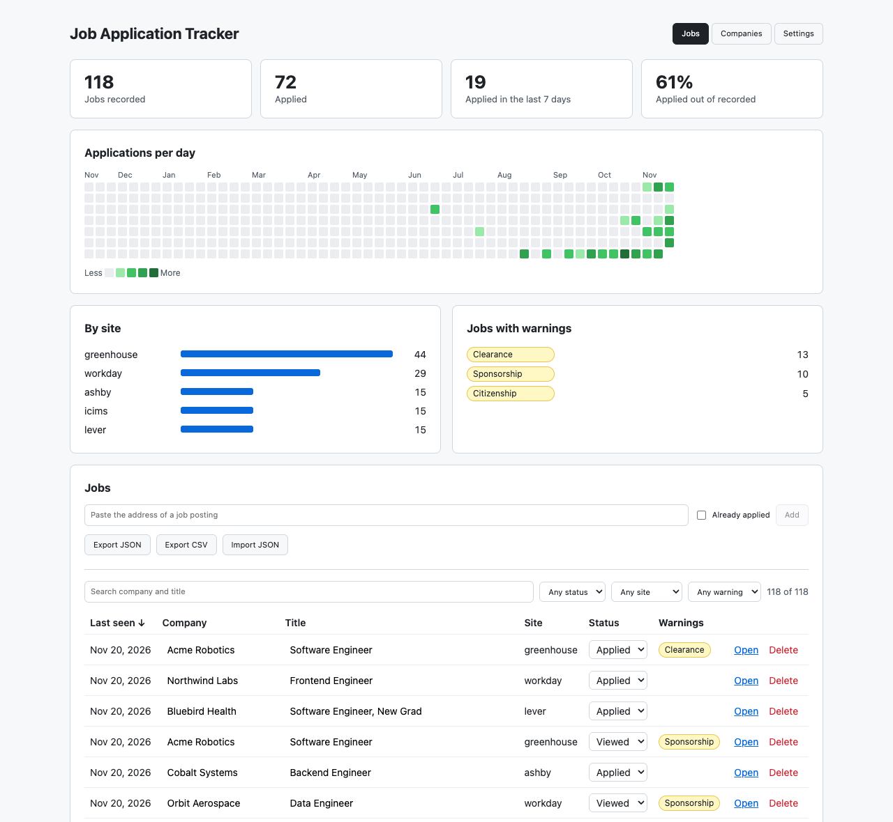
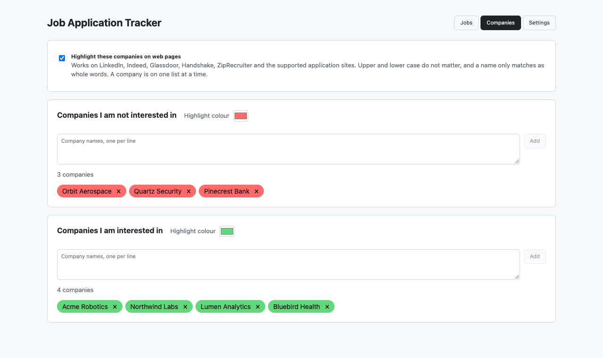

# Job Application Tracker

[English](README.md) | 简体中文

一个浏览器扩展：记住你看过和申请过哪些岗位，不再把同一个岗位点开两遍。所有数据都留在你自己的浏览器里。

## 它解决什么问题

同一个岗位会同时出现在 LinkedIn、Indeed、Handshake 和公司自己的招聘页上。只看列表，你分不清两条是同一个岗位，还是只是名字一样，只能点进去把职位描述再读一遍。

这些列表最后都会跳到同一个招聘系统（Workday、Greenhouse 等）的申请页面，而那个页面的网址里带着一个固定的岗位编号。这个扩展读取这个编号，记录在本地，当你再次打开看过的岗位时立刻提醒你。

## 功能

- **跨平台认出同一个岗位。** 在受支持的招聘系统页面上，按"系统、公司、岗位编号"识别岗位，忽略网址里的追踪参数。
- **看过就提醒。** 页面右上角弹出一个小框，告诉你"你看过这个岗位"以及具体时间，或者"你申请过这个岗位"。
- **自动记录，或者先问你。** 自动模式下打开岗位即记录；手动模式下先询问。
- **标记已申请。** 在弹框里点一下，或者在你点击申请表的 "Submit application" 按钮时自动标记。两种都可以撤销。
- **限制条件预警。** 扫描职位描述里关于公民身份、安全许可、签证担保的要求，并引用原句，由你自己判断。规则是可以编辑的正则表达式。
- **在招聘平台上高亮公司。** 维护两份名单：不感兴趣的公司和感兴趣的公司。它们的名字会在 LinkedIn、Indeed 等网站上高亮显示，颜色可以自己选。添加方式有三种：工具栏弹出窗口、选中公司名后点右键、一次粘贴一批。
- **数据面板。** 最近一年的每日申请图、统计数字、可搜索可编辑的全部岗位列表，支持导出 JSON 和 CSV。
- **中英文界面。** 默认跟随浏览器语言，也可以在设置里指定。





图中是虚构的示例数据。

## 支持的网站

在以下招聘系统上记录岗位：

| 招聘系统 | 识别的域名 |
| --- | --- |
| Workday | `*.myworkdayjobs.com`、`*.myworkdaysite.com` |
| Greenhouse | `boards.greenhouse.io`、`job-boards.greenhouse.io`（以及 `.eu` 域名） |
| Lever | `jobs.lever.co`、`jobs.eu.lever.co` |
| Ashby | `jobs.ashbyhq.com` |
| iCIMS | `*.icims.com` |
| SmartRecruiters | `jobs.smartrecruiters.com` |
| Workable | `apply.workable.com` |

公司名的高亮在上面这些网站以及 LinkedIn、Indeed、Glassdoor、Handshake、ZipRecruiter 上生效。扩展不会在招聘平台本身记录岗位，这些平台自己有申请记录。

其他网站上的岗位可以手动记录：点工具栏图标，选择 **记录当前页面**，或者在面板里粘贴网址。

## 安装

目前还没有上架 Chrome 应用商店和 Firefox 附加组件商店，需要从源码构建，然后加载到 Chrome 或其他 Chromium 内核的浏览器（Edge、Brave、Arc）。

需要 [Node.js](https://nodejs.org) 22 或更高版本，以及 [pnpm](https://pnpm.io)。

```sh
git clone <这个仓库的地址>
cd <生成的文件夹>
pnpm install
pnpm release
```

然后：

1. 打开 `chrome://extensions`。
2. 打开右上角的 **开发者模式**。
3. 点击 **加载已解压的扩展程序**，选择 `release/job-application-tracker-chrome` 文件夹。

不要移动这个文件夹。浏览器靠文件夹的位置来识别未打包的扩展，移动之后它会被当成另一个扩展，原来的记录就看不到了。

更新时拉取新代码，再运行一次 `pnpm release`，然后在 `chrome://extensions` 里点扩展卡片上的刷新箭头。

Firefox 版本（`pnpm build:firefox`）尚未测试。

## 使用

- **打开一个岗位页面。** 右上角的弹框会告诉你它是新的、看过的还是申请过的。点 `–` 把它收成一个小标签，点 `×` 关闭。
- **工具栏图标。** 显示当前页面的状态，记录扩展没有认出的页面，把公司加入名单，打开面板。
- **选中公司名后点右键**，可以标记为感兴趣或不感兴趣。
- **面板。** "岗位"里是图表、数字和列表；"公司"里是两份名单和颜色；"设置"里是语言、记录方式和预警规则。

## 隐私

- **没有任何网络请求。** 扩展没有服务器，不向任何地方发送数据，也没有统计代码。
- **不需要账号。** 记录保存在你电脑上浏览器的扩展本地存储里。
- **开源。** 它做的所有事情都在这个仓库里。

申请的权限和用途：

| 权限 | 用途 |
| --- | --- |
| `storage` | 在浏览器里保存记录、名单和设置 |
| `activeTab` | 让工具栏弹出窗口读取你当前标签页的网址 |
| `contextMenus` | 标记公司的右键菜单项 |
| 上面列出的网站的访问权限 | 在招聘系统页面上读取岗位编号和职位描述，在招聘平台上高亮公司名 |

扩展不申请"访问所有网站"的权限。

## 你的数据

记录按浏览器的用户配置分别保存。**卸载扩展或清除扩展数据会删除全部记录。** 请用面板里的 **导出 JSON** 做备份；**导入 JSON** 可以恢复，也可以用来迁移到另一个浏览器。导入时会和现有记录合并，不会覆盖。

## 已知的局限

- 嵌在公司自己网站里的岗位（比如 `example.com/careers` 里的 Greenhouse 表单）不能自动识别，请用工具栏弹出窗口手动记录。
- 点击 "Submit" 就会标记为已申请，即使表单因为必填项没填而没有提交成功。这种情况下弹框会留在页面上，可以点 **撤销**。
- SmartRecruiters 的申请表所在的网址认不出是哪个岗位，所以在那里提交不会被检测到。
- 如果公司名很短，又恰好是普通单词（如 Block、Scale），页面上所有这个词都会被高亮。
- 预警规则匹配的是措辞而不是含义，会漏掉一些说法，也会误报一些无害的句子，所以始终会把原句给你看。

## 开发

```sh
pnpm dev        # 启动加载了扩展的 Chrome，代码变化后自动重新加载
pnpm test       # 单元测试（Vitest）
pnpm compile    # 类型检查
pnpm build      # 正式构建，输出到 .output/chrome-mv3
pnpm release    # 构建并复制到 release/，用于手动加载
```

使用 [WXT](https://wxt.dev)、TypeScript 和 React 构建。岗位页面上的弹框是放在 Shadow DOM 里的原生 DOM，不会给你访问的网页带入任何框架。

```
entrypoints/
  content.ts     在岗位页面上运行：识别、记录、弹框、扫描、高亮
  background.ts  打开面板，管理右键菜单
  popup/         工具栏弹出窗口
  dashboard/     面板页面（岗位、公司、设置）
lib/
  ats.ts         岗位网址 -> 招聘系统、公司、岗位编号
  keywords.ts    预警规则和文本扫描
  companies.ts   公司名单和名称匹配
  records.ts     记录、筛选、CSV、导入导出
  stats.ts       统计数字和活动图
  store.ts       读写浏览器存储
  toast.ts       岗位页面上的弹框
  i18n.ts        全部界面文字，中英文
docs/            需求文档和里程碑清单（中文）
```

`lib/` 里的逻辑都有单元测试，测试文件和源文件放在一起。

## 许可证

[MIT](LICENSE)
